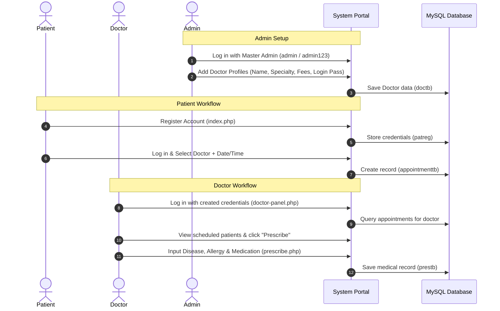

# Hospital Management System (Enterprise ERP)

> An open-source, full-featured Web-based Hospital ERP and Healthcare Management Platform built with PHP, MySQL, and Modern Bootstrap. It provides unified digital workflows for Patients, Doctors, and Hospital Administrators/Receptionists.

---

## 👨‍💻 Developer & Project Info

* **Developer**: **Minesh Rathva** (`mineshrathva533-bit`)
* **Role**: Full Stack Developer | PHP | MySQL | JavaScript | Building Real World ERP Applications
* **License**: Open Source (MIT License - Free to Use)

---

## 🏥 About the Project

### System Overview
The **Hospital Management System** is designed to digitize clinical operations, patient registrations, doctor consultation schedules, medical prescriptions, and administrative reporting into a secure, browser-accessible portal.

### Target Audience & Real-World Use Cases
* **Hospital Administrators & Receptionists**: Manage doctor rosters, patient directories, master schedules, user queries, and data exports.
* **Doctors & Healthcare Specialists**: Track upcoming patient consultations, search patient histories, and issue digital prescriptions.
* **Patients**: Self-register accounts, book medical appointments with specialized doctors, track appointment history, and view prescriptions.

---

## 🎛️ Main Modules

### 1. Patient Portal Module (`admin-panel.php`)
* **Self-Registration & Login**: Account creation capturing personal details, contact number, gender, and password.
* **Appointment Booking**: Select doctor specialization, consultation date, and time slot with automatic fee display.
* **Appointment Tracking**: Live status tracking (Active, Cancelled by Patient, Cancelled by Doctor).
* **Digital Prescription History**: Complete archive of prescribed medications, diagnosed conditions, and allergy notes.

### 2. Doctor Portal Module (`doctor-panel.php`)
* **Consultation Roster**: Real-time listing of scheduled patient appointments.
* **Patient Search & Contact Lookup**: Quick lookup of patient medical records by phone number or email.
* **Prescription Generator (`prescribe.php`)**: Form-based engine capturing disease diagnosis, allergies, and prescribed dosage instructions.
* **Status Updates**: Accept or cancel patient appointments.

### 3. Administrator / Receptionist Module (`admin-panel1.php`)
* **Central Command Dashboard**: Overview of hospital statistics and quick shortcuts.
* **Doctor Roster Management**: Add new doctors with specialty and fees or delete inactive profiles.
* **Master Patient Directory**: View and manage all registered patient accounts.
* **Global Appointment Ledger**: Complete record of all hospital consultations with filtering.
* **Feedback & Query Inbox**: Centralized inbox capturing queries submitted from the public contact page.

---

## ⭐ Features

- **Enterprise Design System (`hospital-theme.css`)**: Teal color system (`#0F766E`) with responsive flex layouts and modern typography (`Inter`).
- **Multi-Role Authentication**: Distinct login panels for Patients, Doctors, and Administrators.
- **Dynamic Consultation Fees**: Automatic fee calculations based on selected medical specialty.
- **Instant Search**: Real-time search across Doctors, Patients, and Appointments by phone number or email.
- **Native Action Export Toolbar (`js/hms-export.js`)**:
  - 📊 **Excel**: Download table data directly to `.csv` format.
  - 📄 **PDF**: Instant clean PDF printable export.
  - 🖨 **Print**: Native print dialog with `@media print` rules hiding navbars and sidebars.
  - 🔄 **Refresh**: Soft table refresh.
- **Clean UI (No Underlines)**: Clean text styling free of cluttered link underlines.
- **Responsive Layout**: Full support for Desktop, Tablet, and Mobile screens.

---

## 🖥️ System & Software Requirements

### Software Required
1. **XAMPP Control Panel** (Apache + MySQL PHP web server stack)
2. **VS Code** (or any text editor)
3. **Web Browser** (Google Chrome, Firefox, Edge, Safari)

### Environment Specifications
* **PHP**: PHP 7.2 through PHP 8.x
* **Database**: MySQL 5.7+ / MariaDB 10.1+
* **Web Server**: Apache 2.4+
* **Operating System**: Windows 10/11, Linux, or macOS

---

## 🚀 Installation & Setup Guide

### Step 1: Install XAMPP
Download and install **XAMPP** from Apache Friends. Make sure both **Apache** and **MySQL** are checked during installation.

### Step 2: Move Project Files into XAMPP `htdocs`
Extract or copy the project folder into your XAMPP `htdocs` directory:
* **Windows**: `C:\xampp\htdocs\Hospital-Management-System`
* **Linux**: `/opt/lampp/htdocs/Hospital-Management-System`
* **macOS**: `/Applications/XAMPP/htdocs/Hospital-Management-System`

---

## 🗄️ How to Import Database in XAMPP (phpMyAdmin)

Follow these exact step-by-step instructions to import the database file (`myhmsdb.sql`) into XAMPP:

1. **Start Apache & MySQL in XAMPP**:
   - Open the **XAMPP Control Panel**.
   - Click the **Start** button next to **Apache**.
   - Click the **Start** button next to **MySQL** (make sure both show green status).

2. **Open phpMyAdmin**:
   - Open your web browser (Chrome/Edge/Firefox).
   - Go to: `http://localhost/phpmyadmin`

3. **Create Database**:
   - On the left sidebar of phpMyAdmin, click **New**.
   - Under **Database name**, enter: `myhmsdb`
   - Select collation: `utf8mb4_general_ci` (or default).
   - Click **Create**.

4. **Import Database SQL File**:
   - Select the newly created `myhmsdb` database from the left sidebar.
   - Click on the **Import** tab located on the top navigation bar.
   - Click **Choose File** (or **Browse**).
   - Navigate to your project folder (`htdocs/Hospital-Management-System`) and select `myhmsdb.sql`.
   - Scroll down to the bottom of the page and click **Import** (or **Go**).

5. **Verify Database Import**:
   - You will see a success message: *"Import has been successfully finished, queries executed."*
   - Verify that the tables (`admintb`, `appointmenttb`, `contact`, `doctb`, `patreg`, `prestb`) appear under `myhmsdb`.

---

## 🌐 How to Launch & Run Application

1. Make sure Apache and MySQL are running in XAMPP.
2. Open your web browser and enter the URL:
   ```text
   http://localhost/Hospital-Management-System
   ```
   *(Or if using PHP dev server, open terminal in project directory, run `php -S localhost:8000`, and go to `http://localhost:8000`)*

---

## 🔑 Default Master Admin Credentials

> [!NOTE]
> The database is 100% clean and fresh out-of-the-box. Use the Default Master Admin credentials below to log in, add doctors, and manage the system.

### 🛡️ Administrator / Receptionist
* **Username**: `admin`
* **Password**: `admin123`

---

## 🔄 How the System Works (Workflow)



---

## 📁 Project Structure

```text
Hospital-Management-System/
├── assets/                  # Static CSS/theme variations
├── css/                     # Primary component styling
├── font-awesome-4.7.0/      # Local icon font library
├── js/                      # Frontend JavaScript engines
│   └── hms-export.js        # Reusable Export Engine (Print, PDF, Excel CSV)
├── vendor/                  # Vendor plugins (Bootstrap, FullCalendar, JCrop)
├── admin-panel.php          # Patient Dashboard & Appointment Booking Portal
├── admin-panel1.php         # Receptionist / Admin Master Management Portal
├── doctor-panel.php         # Doctor Dashboard & Consultation Portal
├── prescribe.php            # Medical Prescription Generator Form
├── doctorsearch.php         # Doctor Search Filter
├── patientsearch.php        # Patient Search Filter
├── appsearch.php            # Appointment Search Filter
├── messearch.php            # Query Search Filter
├── search.php               # General Contact Search Handler
├── func.php                 # Core Patient Functions & DB Connection
├── func1.php                # Core Doctor Functions & DB Connection
├── func2.php                # Core Admin Functions & DB Connection
├── func3.php                # Search Helper Functions
├── index.php                # Public Home & Tabbed Login Portal
├── contact.html             # Public Contact Form
├── services.html            # Healthcare Services Page
├── logout.php               # Patient Logout Session Handler
├── logout1.php              # Doctor & Admin Logout Session Handler
├── hospital-theme.css       # Master Global Theme Engine (Teal System)
├── myhmsdb.sql              # Database Schema (Clean Production Dump)
├── LICENSE                  # Open Source MIT License (Minesh Rathva)
└── README.md                # Project Documentation
```

---

## 📄 License & Copyright

This project is **Free and Open Source Software** released under the **MIT License**.

Copyright © 2026 **Minesh Rathva** (`mineshrathva533-bit`). All Rights Reserved.
